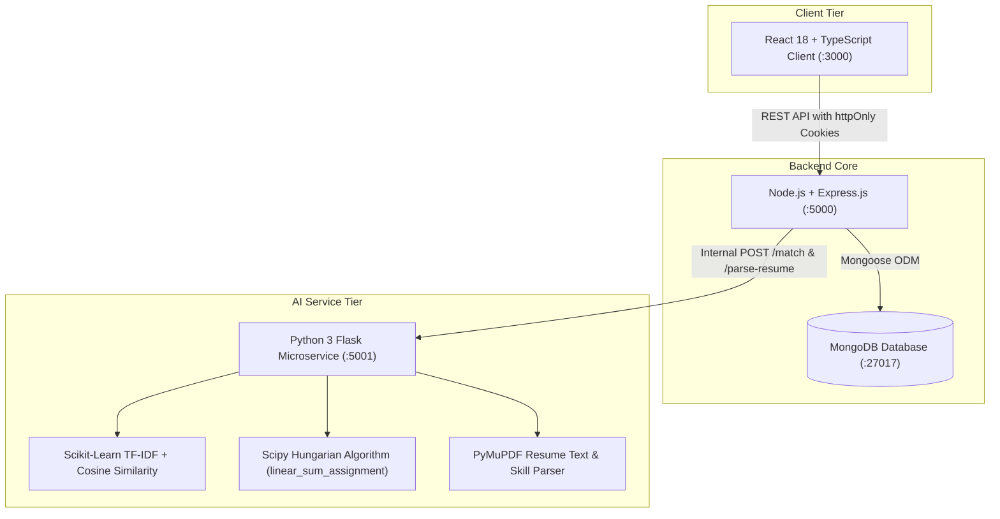

# ✦ Allocation AI — Intelligent Internship Matching

### Full-Stack MERN + Python Microservice Platform for AI-Driven Internship Allocation

> **Warning: Educational Prototype.** This is a demonstration project. All accounts, organizations, and data are simulated. It is **not affiliated with or endorsed by any government body** and produces no official, legally binding allocations.

[]()
[]()
[]()

An end-to-end platform that replaces manual internship placement with an autonomous AI matching engine built on **TF-IDF Competency Vectorization**, **Cosine Similarity**, skill/geography/domain preference scoring, and the **Hungarian Algorithm (Kuhn-Munkres)** for globally optimal candidate–slot assignment. The UI is a dark, premium AI-SaaS experience with role-based consoles for Students, Organizations, and an Admin Command Center.

---

## 🏗️ System Architecture



---

## 🚀 Quick Start with Docker Compose

```bash
cd "c:\Users\ishan\OneDrive\Desktop\Major"

# Configure environment (docker-compose env)
cp .env.example .env

# Build and launch all 4 services
docker-compose up --build
```

- **Web Portal (Client)**: [http://localhost:3000](http://localhost:3000)
- **Core API Server**: [http://localhost:5000](http://localhost:5000)
- **AI Matching Engine**: [http://localhost:5001/health](http://localhost:5001/health)
- **MongoDB**: `localhost:27017`

---

## 🌱 Database Seeding

Generates **1 Administrator**, **30 Organizations** (across 10 sectors and states, 75+ slots), and **300 Student applicants** with realistic CGPA distributions and quota representation, spread over the last 30 days for meaningful analytics charts.

```bash
cd server
npm run seed
# or: node seed.js
```

### Demo Credentials

| Role | Email | Password | Scope |
| :--- | :--- | :--- | :--- |
| **Admin** | `admin@allocation-ai.test` | `Admin@123` | Command Center, 8-Step Engine Trigger, Manual Overrides, CSV Reports, User Governance |
| **Company** | `company1@example.com` | `Company@123` | Slot Capacity Management, Candidate Match Dossiers, Accept/Reject, CSV Export |
| **Student** | `intern1@example.com` | `Intern@123` | 5-Step Competency Profile, PDF Resume AI Parsing, Score Breakdown, Confetti |

---

## 🧠 AI Algorithm Breakdown

1. **Competency Vectorization (TF-IDF)**: Student skills vs. slot required/preferred skills → sparse term-frequency matrices using n-grams `(1, 2)`. Cosine similarity scores every active student against every vacancy.
2. **Multi-Factor Strategic Scoring**:
   - **Geographic Match**: `+0.20` if candidate's preferred state matches the slot location.
   - **Home State Bonus**: `+0.08` if candidate's permanent state aligns with the location.
   - **Domain Alignment**: `+0.12` if candidate expressed interest in the slot's sector.
   - **Academic Merit (CGPA)**: Tiered bonuses (`+0.10` ≥ 8.5, `+0.07` ≥ 7.5, `+0.05` ≥ 6.5) — only if slot has no explicit CGPA gate.
   - **Strict Gate**: CGPA below the slot's minimum invalidates the score (`-999.0`).
3. **Seat Expansion & Quota-Aware Hungarian**: slot seats scale by `max(1, int(seats * q))`; quota sub-matrices (SC/ST/OBC/PH/General) enforce per-slot caps; `scipy.optimize.linear_sum_assignment` maximizes the cumulative cohort score.
4. **Per-Component Explainability**: every allocation stores a component-wise `matchReason` breakdown (skills, geography, domain, academic), which the Student-facing Score Breakdown renders.

---

## 🔒 Security Notes

- **JWT Cookies** in `httpOnly`, `sameSite=strict` cookies (7-day expiry).
- **Aadhar Privacy**: only `aadharLast4` + SHA-256 `aadharHash` are stored — never the raw number.
- **File Storage**: local Multer `diskStorage` → `./uploads/` with MIME verification (no external cloud keys).
- **Rate Limiting**: auth endpoints limited to 20 requests/minute.

---

## 💻 Manual Setup (No Docker)

### 1. Python AI Microservice
```bash
cd ai-service
python -m venv venv
# Windows: venv\Scripts\activate | Unix: source venv/bin/activate
pip install -r requirements.txt
python -m spacy download en_core_web_sm
python app.py
```

### 2. Node.js Express Backend
```bash
cd server
npm install
node seed.js
npm start
```

### 3. React Frontend Client
```bash
cd client
npm install
npm run dev
```
Open [http://localhost:3000](http://localhost:3000).

---

## 📜 Feature Checklist

- [x] Docker Compose orchestration for all 4 services with healthchecks
- [x] Seeder: 1 Admin, 30 Organizations, 75+ Slots, 300 Students
- [x] Production AI engine: TF-IDF, Cosine Similarity, quota-aware Hungarian, seat expansion
- [x] PyMuPDF PDF resume parser with regex fallback taxonomy
- [x] Dark premium SaaS theme (Linear/Vercel-styled), dark-mode toggle defaulting to dark
- [x] Student 5-step onboarding wizard with India state map and masked Aadhar
- [x] Organization vacancy manager + accept/reject workflow
- [x] Admin Command Center: KPIs, analytics charts, 8-step live engine-run progress
- [ ] Engine run history, reallocation, and per-run stats
- [ ] Configurable scoring weights (admin System Config)
- [ ] Full audit log for administrative actions
- [x] 6 modern Nodemailer email templates (branded, prototype-disclaimed)
- [x] CSV exports for allocations and organization rosters